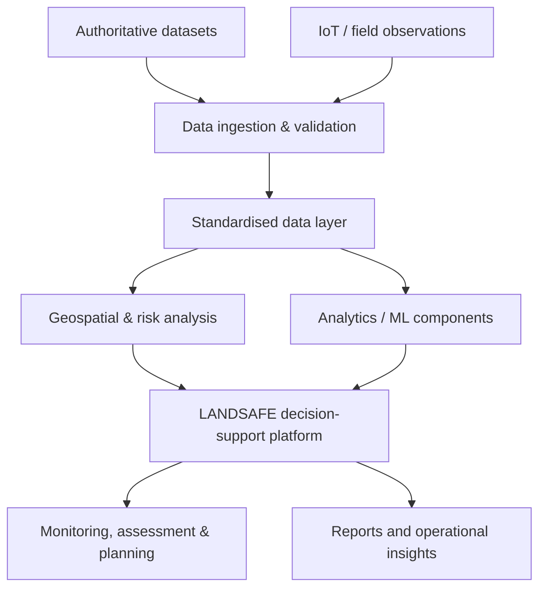
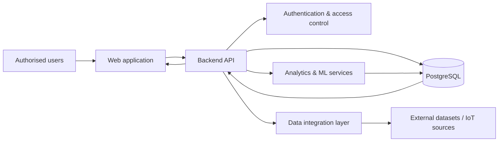

# LANDSAFE

### Integrated Disaster Intelligence & Decision Support System

LANDSAFE is a disaster intelligence and decision-support platform designed to help regional disaster-management stakeholders turn fragmented hazard information into clearer situational awareness, risk insights, and preparedness actions. By bringing together geospatial information, monitoring data, analytical models, and operational planning tools, LANDSAFE aims to support more informed and coordinated disaster-risk management.

> **Project status:** Under active development. Capabilities and data availability depend on the configured deployment, connected data providers, and validated field inputs.

---

## Contents

- [Why LANDSAFE](#why-landsafe)
- [What LANDSAFE Does](#what-landsafe-does)
- [Platform Modules](#platform-modules)
- [How It Works](#how-it-works)
- [System Architecture](#system-architecture)
- [Technology Stack](#technology-stack)
- [Data Integration and Reliability](#data-integration-and-reliability)
- [Getting Started](#getting-started)
- [Security and Responsible Use](#security-and-responsible-use)
- [Limitations](#limitations)
- [Roadmap](#roadmap)
- [Contributing](#contributing)
- [License](#license)

## Why LANDSAFE

Disaster-management decisions often require information from multiple domains: weather and seismic observations, geological conditions, hazard and exposure maps, local monitoring devices, and reports from the field. These sources may use different formats, update schedules, geographic references, and access mechanisms.

When relevant information is difficult to combine and interpret, agencies may face delays in building a shared operational picture, assessing potential impacts, and prioritising preparedness measures.

LANDSAFE is being developed to address this information gap through a unified, modular decision-support environment. Its purpose is not to replace disaster-management authorities or official warning systems, but to make relevant information easier to inspect, analyse, and use in planning.

## What LANDSAFE Does

LANDSAFE brings together four connected capabilities:

1. **Observe** — present monitoring information, maps, sensor observations, and alerts in a shared operational view.
2. **Understand** — support hazard and vulnerability assessment, spatial analysis, and scenario-based impact exploration.
3. **Prepare** — help organise mitigation priorities, contingency planning, evacuation considerations, and resource readiness.
4. **Coordinate** — provide a structured information environment for incident visibility, field reporting, and operational decision support.

The platform is designed to be modular so that data sources, analytical components, and operational workflows can be improved independently.

## Platform Modules

The platform is organised around the disaster-management lifecycle. The availability of each module may differ between development, demonstration, and deployed environments.

| Area | Modules | Purpose |
|---|---|---|
| **Overview** | Dashboard | Summarise key indicators and the current operational picture. |
| **Situational Awareness** | Live Map, Alert Center, Sensor Analytics | Visualise geographic conditions, monitoring observations, and relevant alerts. |
| **Risk & Intelligence** | Risk Assessment, Scenario Analysis, Digital Twin, AI Analytics | Examine risk factors, explore possible impacts, and present analytical insights. |
| **Preparedness & Mitigation** | Mitigation Planning, Contingency Planning, Simulations & Exercises | Support preparedness activities and the prioritisation of risk-reduction actions. |
| **Emergency Operations** | Incident & Operations Management, Field Reporting, Resource Management | Organise incident information and support coordination during response activities. |
| **Data & Administration** | Data Integration, Device Management, Users, Settings, Audit Logs, Reports | Manage connected information sources, platform access, system configuration, and records. |

## How It Works

At a high level, LANDSAFE follows a data-to-decision workflow:

1. **Data acquisition** — receive information from configured public datasets, geospatial resources, and monitoring devices.
2. **Validation and standardisation** — check incoming records, timestamps, units, geographic references, and source metadata before they are used.
3. **Data storage and processing** — store structured records and prepare relevant information for mapping and analysis.
4. **Risk and analytical assessment** — apply configured geospatial methods and machine-learning components to support interpretation.
5. **Decision support** — present maps, indicators, alerts, scenarios, reports, and planning tools to authorised users.

### Conceptual data flow



## System Architecture

LANDSAFE uses a modular application architecture with a backend API, relational data storage, analytical components, and a web-based operational interface.



The architecture is intended to keep data ingestion, application logic, persistence, and analytics separable. This makes it easier to add or replace data adapters and analytical services without redesigning the entire platform.

## Technology Stack

The following technologies are part of the current project architecture; exact components may vary by service or deployment.

| Layer | Technology |
|---|---|
| Runtime | Node.js (ES Modules) |
| Backend API | Express 5 |
| Database | PostgreSQL |
| Data access | Drizzle ORM |
| Authentication | JWT and bcryptjs |
| Validation & API contracts | Zod and OpenAPI |
| Logging | Pino |
| Package management | pnpm |
| Machine learning | Python-based analytics, including XGBoost components |
| Edge / monitoring concept | ESP32-based sensor nodes |

## Data Integration and Reliability

LANDSAFE is intended to work with relevant, authoritative information sources. Potential sources include Indonesian disaster, meteorological, geological, and geospatial data providers such as **BMKG**, **PVMBG**, **BNPB**, and **InaRISK**, subject to data availability, access conditions, and the technical interfaces provided by each institution.

A source being listed here does **not** mean that a live API connection is already available or continuously operational. Each integration must be implemented and validated individually.

To keep analytical results traceable, every integrated dataset should retain, where available:

- Source institution and dataset name.
- Original record identifier or source URL.
- Observation time and retrieval time.
- Geographic coverage and coordinate reference information.
- Units, schema version, and transformation history.
- Data quality status and known limitations.

LANDSAFE should not silently treat missing, stale, incomplete, or unverified data as current facts. Analytical outputs should be interpreted in the context of their input coverage, model assumptions, and validation status.

## Getting Started

### Prerequisites

- Node.js 24 or a compatible version supported by the project.
- pnpm.
- PostgreSQL, configured for the application.
- Python and the required Python environment if the selected analytics or machine-learning services are enabled.

### Installation

```bash
# Clone the repository
 git clone https://github.com/Khoberpn/LANDSAFE

cd LANDSAFE

# Install JavaScript dependencies
 pnpm install
```

### Environment configuration

1. Check the repository for an environment template such as `.env.example`.
2. Create the local environment file using the template provided by the project.
3. Configure the database connection and required application secrets.
4. Configure optional data-provider credentials and analytics services only when they are supported by the current deployment.
5. Never commit real credentials, private keys, or production secrets to version control.

### Run the application

Inspect the scripts available in `package.json`:

```bash
pnpm run
```

Then execute the appropriate development, migration, test, or production script documented by the repository. The exact commands depend on the scripts and services included in the checked-out version.

## Security and Responsible Use

Because LANDSAFE may handle operational information, monitoring records, and user accounts, deployments should:

- Keep authentication and authorisation enabled for protected functions.
- Apply role-based access control and least-privilege permissions.
- Protect ingestion endpoints against unauthorised submissions.
- Store secrets in environment variables or a dedicated secrets manager.
- Validate and log data ingestion without exposing credentials or sensitive information.
- Keep audit records for relevant administrative and operational actions.
- Use HTTPS and secure database access in deployed environments.

**LANDSAFE is a decision-support tool.** It does not replace official warnings, professional assessment, emergency procedures, or instructions issued by authorised government agencies. Users must verify critical information with the responsible authorities before taking action.

## Limitations

- Data coverage and update frequency depend on the sources configured in each deployment.
- External government datasets may have access restrictions, changing schemas, service interruptions, or limited historical coverage.
- Sensor observations may require calibration, maintenance, and field validation.
- Model outputs are affected by input quality, assumptions, and local conditions; they should not be interpreted as guaranteed predictions.
- A feature shown in the platform interface may still be under development and should not be assumed operational without testing.

## Roadmap

Development priorities may include:

- Strengthening reliable, traceable integrations with authoritative data providers.
- Improving geospatial data validation and cross-source harmonisation.
- Validating risk-analysis and machine-learning components against appropriate reference data.
- Expanding preparedness workflows, scenario exercises, and resource-planning support.
- Improving field reporting, auditability, access control, and deployment reliability.

## Contributing

Contributions, technical reviews, and research collaboration are welcome.

1. Review the existing architecture and coding conventions before making changes.
2. Create a focused branch for your contribution.
3. Include relevant tests and documentation for behavioural changes.
4. Document new data sources, transformations, assumptions, and limitations.
5. Open a pull request describing the motivation, implementation, and validation performed.

For changes involving official datasets or analytical models, include enough provenance and evaluation detail for others to reproduce and review the result.

## License

No open-source license is specified in this README. Unless a `LICENSE` file states otherwise, do not assume that the code is available for reuse, modification, or redistribution. Add the license selected by the project owner before presenting LANDSAFE as an open-source project.

---

<p align="center">
  <strong>LANDSAFE</strong><br />
  <em>Turning disaster data into actionable preparedness insights.</em>
</p>
